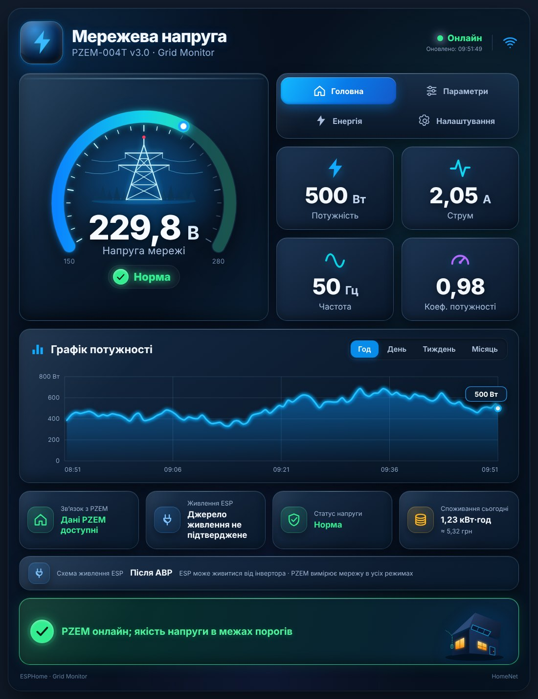
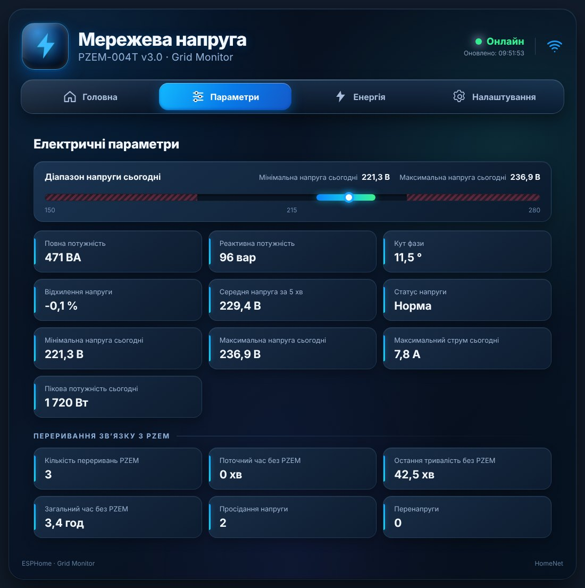

# Smart Grid Monitor

ESPHome firmware and Home Assistant interfaces for an ESP32-C3 + PZEM-004T v3.0 household grid monitor. The project reports live voltage, current, power, frequency, power factor, energy, cost, grid-quality events, PZEM communication outages, diagnostics, configuration controls and safe reset actions.

The repository now provides two supported interface paths. The recommended path is the HACS-installable `Smart Grid Monitor Card`, a responsive dark-neon frontend card. The dependency-free native Lovelace dashboard remains available as a fallback for installations where custom frontend resources are not desired.

## Preview

| Home (desktop) | Home (phone) |
| --- | --- |
|  |  |

| Parameters | Settings and diagnostics |
| --- | --- |
|  |  |

The previews are rendered from the card with sample data; they are not live Home Assistant captures.

## ESPHome setup and secret safety

1. Copy `esphome/secrets.example.yaml` to `esphome/secrets.yaml`.
2. Replace every `REPLACE_WITH_…` placeholder with your own values before compiling or flashing. Use different passwords for the fallback access point and OTA, each at least 16 characters; do not reuse the template or the Wi-Fi password.
3. Run `python3 esphome/check_secrets.py` from the repository root. The check reports missing or placeholder keys without printing any secret values.
4. Compile and flash with ESPHome after the check passes. The secret preflight uses PyYAML, which is included in an ESPHome Python environment; otherwise install the test dependency with `python3 -m pip install -r requirements-test.txt`.

Run the repository's fast local checks before opening a pull request:

```bash
python3 -m pip install -r requirements-test.txt
node --check grid-monitor-card.js
python3 -m unittest discover -s tests -v
```

After updating the firmware, the communication entities are `binary_sensor.grid_monitor_pzem_online`, `binary_sensor.grid_monitor_pzem_offline`, and `sensor.grid_monitor_power_source_status`. `binary_sensor.grid_monitor_on_inverter` is no longer provided because the project has no independent inverter/ATS input. Update any external automations that relied on the old inferred inverter entity.

## HACS installation

1. Open **HACS → Frontend → Custom repositories**.
2. Add `https://github.com/kdinya/ha-Smart-Grid-Monitor` and select **Dashboard / Lovelace**.
3. Install **Smart Grid Monitor Card**.
4. Refresh the Home Assistant browser or companion app. HACS normally registers the JavaScript resource automatically.
5. Add a manual card with the example below, or use the card picker.

```yaml
type: custom:grid-monitor-card
```

The card uses the default ESPHome prefix `grid_monitor`. If the device has another name, set `prefix` or provide explicit entity overrides:

```yaml
type: custom:grid-monitor-card
language: uk
name: Електрика будинку
prefix: grid_monitor
esp_power_mode: after_avr
```

`language` accepts `uk` or `en`. If omitted, the card follows the Home Assistant language when it can detect it. `esp_power_mode` accepts `grid_shared`, `after_avr` or `independent` and defaults to `after_avr`. It describes how the ESP is powered; PZEM readings remain measurements of the mains in every mode, and the card does not infer the ESP supply from grid sensors. The card safely displays missing, unavailable and unknown entities instead of failing the whole dashboard. Loss of PZEM communication is reported as unavailable telemetry and an unknown power source; it is not treated as proof that the ESP is running from an inverter. The current firmware has no independent ATS/inverter confirmation input. Reset and restart actions ask for confirmation before calling the corresponding ESPHome button service.

Card display options such as the name, ESPHome prefix, language, ESP power arrangement and entity overrides belong to the Lovelace dashboard configuration, not to browser-local storage. Storage-mode dashboards keep that configuration in Home Assistant so the same dashboard uses it on each client; YAML-mode dashboards keep it in the dashboard YAML. ESPHome device settings such as voltage thresholds, tariff values and the two-zone switch are separate device entities and already use ESPHome restore settings, so they persist on the controller across restarts.

## Manual card installation

Download `grid-monitor-card.js` into `<config>/www/`, add `/local/grid-monitor-card.js` as a **JavaScript module** under **Settings → Dashboards → Resources**, then refresh the browser. HACS is preferred because it manages the resource and updates.

## Native dashboard fallback

Copy [`home-assistant/lovelace/grid-monitor-dashboard.yaml`](home-assistant/lovelace/grid-monitor-dashboard.yaml) into a dashboard's raw configuration editor. It uses only built-in Home Assistant cards and has no HACS dependency. Installation details and the optional source-status and health package are in [`home-assistant/README.md`](home-assistant/README.md).

## Repository layout

```text
esphome/
  grid-monitor.yaml       # ESPHome firmware
  secrets.example.yaml    # safe secret names and placeholders
home-assistant/
  lovelace/                # native dependency-free dashboard
  packages/                # optional derived source/health sensors
grid-monitor-card.js       # HACS Lovelace card
docs/
  design-grid-monitor.md   # visual sketch and interaction decisions
AGENTS.md                  # repository contribution and AI rules
hacs.json                  # HACS frontend metadata
```

## Coverage

Both interfaces cover the firmware's live electrical values, energy and cost counters, tariff settings, voltage quality and peaks, PZEM communication outage counts and durations, ESP diagnostics, configuration numbers, two-zone tariff switch, reset buttons and restart button. The frontend reads entities exposed by ESPHome; it does not infer inverter operation from a PZEM timeout.

## Electrical safety

The PZEM module is connected to mains-voltage wiring. Use an enclosed, strain-relieved installation, keep the low-voltage and mains sections isolated, and work only with the breaker disconnected. Have a qualified electrician verify the CT and mains wiring if anything is uncertain.

## Development workflow

Use focused feature branches and pull requests. Run `node --check grid-monitor-card.js`, validate `hacs.json`, run the ESPHome-secret-aware YAML checks when YAML changes, and run `git diff --check` before pushing. Never commit `esphome/secrets.yaml`, credentials or access tokens.

## License

See [LICENSE](LICENSE).
